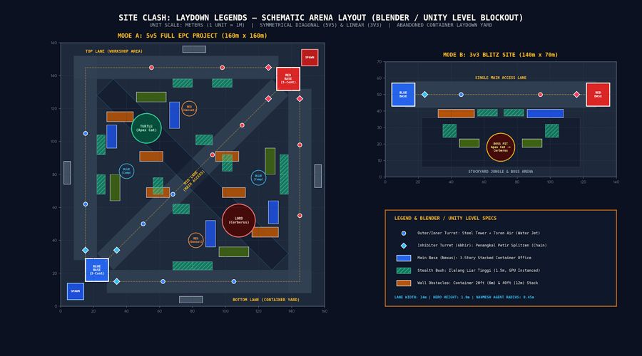

# SITE CLASH: Laydown Legends

MOBA 3D bertema proyek EPC / konstruksi. Server berjalan di **laptop ini** (tanpa server kantor / cloud),
pemain masuk lewat **browser** di PC atau HP yang terhubung ke WiFi / hotspot yang sama.



## Cara main (tuan rumah / laptop server)

1. Pasang [Node.js](https://nodejs.org) 18+ (sekali saja).
2. Klik dua kali **`START_SERVER.bat`** — dependensi otomatis terpasang, server jalan di port 3000, browser terbuka.
3. Jendela server menampilkan alamat untuk perangkat lain, misalnya `http://192.168.0.181:3000`.
4. Jika Windows Firewall bertanya, pilih **Allow** untuk *Private network*.
5. Teman membuka alamat itu di browser HP / laptop (satu WiFi atau hotspot yang sama), isi nama, pilih tim & hero.
6. Host (pemain pertama) memilih mode **1v1 / 2v2 / 3v3 Blitz** atau **5v5 Full EPC** lalu **Mulai Proyek!** — slot kosong diisi bot.

Manual: `npm install` lalu `npm start`. Ganti port: `set PORT=8080 && npm start`.

## Main online bersama teman (internet)

1. Klik dua kali **`START_ONLINE.bat`**. Server jalan di laptop ini, lalu Cloudflare Tunnel (gratis, resmi) membuat link publik seperti
   `https://kata-kata-acak.trycloudflare.com`.
2. Link tampil di jendela server **dan di lobby** (tombol *Salin*). Kirim ke teman. Mereka cukup buka link itu di browser HP/PC, tanpa install.
3. Link berganti setiap server dinyalakan ulang. Laptop harus tetap menyala & terhubung internet selama main.
4. Mode 5v5 penuh = 10 pemain; tiap pemain butuh ±50 KB/s. Upload internet laptop ±5 Mbps sudah cukup.

## Kontrol

| | PC | HP (landscape) |
|---|---|---|
| Jalan | WASD / panah | joystick: sentuh & geser di kiri layar |
| Serang | tahan SPASI | tahan tombol ⚔ |
| Skill | Q / E / R, bidik dengan mouse, lepas untuk cast | ketuk = auto-aim, geser tombol = bidik manual, lepas di **BATAL** untuk batal |
| Recall | B | 🏠 |
| Toko / skor | P / Tab | 🛒 / 📋 |

Tips HP: buka menu browser → *Add to Home screen* supaya layar penuh.

## Mode permainan (sesuai GDD & denah)

| | 3v3 Blitz Site | 5v5 Full EPC Project |
|---|---|---|
| Map | 140×70 m, 1 lane + Stockyard jungle | 160×160 m, 3 lane (Top: Workshop Fabrikasi, Mid diagonal: Jalan Utama Laydown, Bottom: Tumpukan Kontainer) + jungle |
| Struktur per tim | Toren Air → Penangkal Petir → Base | per lane: Toren Air outer → Toren Air inner → Penangkal Petir; base terbuka saat salah satu Penangkal Petir runtuh |
| Boss | Apex Alley Cat (1:15), berganti Cerberus (4:00) | Turtle: Apex Alley Cat (1:30) · Lord: Cerberus (6:00), dua pit terpisah |
| Durasi (uji bot vs bot) | ±8–15 menit | ±11–20 menit, overtime mulai menit 15 |

Map 5v5 simetris titik (diputar 180°) supaya kedua tim adil. Bot 5v5 dibagi ke lane top / mid / bot / bot / mid.
Di map 5v5 server hanya mengirim minion & proyektil dalam radius 50 m dari hero tiap pemain, supaya WiFi laptop tidak terbebani.

## Isi versi 0.2

- **Arena**: kontainer sebagai dinding, ilalang = Stealth Bush, kontainer keliling dibuat otomatis dari batas area.
- **Struktur**: Toren Air (water jet: slow + armor shred), Penangkal Petir (chain lightning 3 target, aktif setelah toren runtuh),
  Kontainer Office 3 lantai (base). Backdoor protection, super wave, overtime setelah menit 10.
- **Minion**: Kucing Penjaga (melee), Anjing Patroli (ranged), Mastiff Gerobak (siege tiap 3 gelombang).
- **Boss**: The Apex Alley Cat (hadiah Shield Debu Beton), Cerberus of the Yard (ikut push lane terdekat bersama tim pembunuh).
- **5 hero starter** dengan pasif + 3 skill: Structural Engineer, HSE Officer, Drafter (CAD/BIM), Estimator/QS, Surveyor.
  15 hero lain tampil di lobby sebagai "segera hadir".
- **Toko 6 slot**: komponen Tier 1 → item Tier 3 EPC beserta pasifnya, quick-buy rekomendasi per hero, jual 60%.
- **Bot AI**: farming, trade, mundur & recall, beli item, ambil boss.
- **SFX prosedural** (WebAudio) memakai Asset Key dari katalog audio GDD — tanpa file .wav.
- **Rank lokal** EPC Career Ladder (Trainee → EPC Director) + Project Points, disimpan di browser masing-masing.

## Struktur kode

```
server/index.js   HTTP statis + WebSocket, lobby, loop 30 Hz
server/game.js    simulasi server-authoritative (combat, skill, struktur, minion, boss, stealth)
server/bot.js     AI bot hero
shared/data.js    data hero, item, MAPS (blitz & full: lane waypoint, struktur, pit, semak), balance
client/           Three.js renderer, HUD, kontrol, SFX
tools/simtest.js  uji cepat full-bot tanpa grafis: node tools/simtest.js [menit] [blitz|full]
tools/make_thumbs.py  bikin thumbnail JPG dari concept art PNG
```

Balance di-tuning lewat `shared/data.js`; cek hasilnya dengan `node tools/simtest.js 20 full`.

## Karakter 3D, animasi & skin (v0.3)

- **20 hero terbuka semua**, masing-masing model 3D ber-rig (Blender) dengan seragam, helm, rompi reflektif, hijab, visor, dan alat khas sesuai concept art.
- Base tubuh & 22 animasi dari Quaternius *Universal Base Characters* + *Universal Animation Library* (lisensi **CC0**). Sumber zip tidak di-commit (`_vendor_assets/`).
- Animasi: idle, lari/sprint, serangan (pedang/pukulan/tembak/sihir), cast skill, kena stun, recall, mati, menari saat menang.
- **4 tingkat skin** (semua terbuka): Default · Elite *Night-Shift Overtime* (neon warna role) · Epic *Client Gala* (emas) · Legend *Master EPC Exoskeleton* (logam + inti cyan + aura).
- VFX: bloom, partikel cahaya, jejak proyektil, gempa layar, kontainer/kandang baja jatuh, konvoi truk molen, turret SCADA, zona es/lumpur/minyak, pusaran turbin.
- Kualitas grafis otomatis (HP: sedang). Ubah lewat konsol: `localStorage.sc_quality = 'low' | 'med' | 'high'`.
- Membangun ulang model: buka Blender (add-on MCP aktif) lalu jalankan `tools/blender/build_heroes.py` → `build_all()` dan `build_anims()`. Spesifikasi tampilan tiap hero ada di `tools/blender/hero_specs.py`.
- Uji balance: `node tools/herostats.js 40` (persentase menang per hero dari match bot).

## Dunia realistis (v0.4)

- **Laydown kumuh & nyata**: beton retak, kerikil, tanah, marka pudar, noda oli, jejak ban dan tulisan area di-*bake* jadi satu tekstur tanah; genangan memantulkan langit senja (HDRI); bayangan matahari sore.
- **Kontainer berkarat** ditumpuk tidak rapi (miring, bergeser, ada yang tumbang) + puing: drum, ban bekas, peti, palet, kantong sampah, barrier beton, baja H, pipa, gulungan kabel, genset.
- **Rumput & gulma foto-scan** (12 jenis): ilalang di semak sembunyi, gulma di retakan beton dan kaki kontainer, bergoyang kena angin.
- **Turret & base** model baru: menara toren air rangka baja berkarat, menara penangkal petir + trafo, office kontainer 3 lantai.
- **Turtle = Rust Dozer D9, Lord = Iron Claw Excavator** (alat berat tua berkarat, mesin bergetar, asap knalpot, bilah/boom bergerak saat menyerang). Minion kucing & anjing model baru berkaki, ekor dan kepala bergerak.
- **Hero**: 20 bentuk tubuh berbeda (gendut, tinggi, kekar, kecil), perlengkapan beragam, bahan kain/denim/kulit/plastik/logam (normal map), gerakan jurus per hero (tebas, tusuk, loncat-hantam, terobos, guling, putar).
- **Kamera** sudut ±55° lensa 36°; **nama & bar darah** berjangkar di atas kepala sesuai tinggi tiap hero.
- **Kualitas adaptif**: tinggi (bloom + bayangan 2048), sedang (bayangan 1024), rendah (tanpa bayangan). Turun otomatis bila FPS < 33.
- Aset CC0: tekstur/model/HDRI dari [Poly Haven](https://polyhaven.com) (`python tools/fetch_polyhaven.py`), model dibuat lewat `tools/blender/build_props.py`.

## Rencana berikutnya

Fog of war untuk 5v5, camp jungle (Genset/Comp buff), draft pick & ban, model 3D minion & boss (kucing/anjing) dari Blender,
animasi intro/showcase per hero, dan versi Unity (APK) bila diperlukan.
